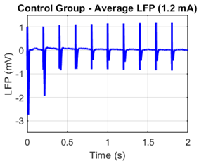
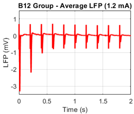
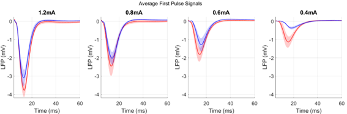
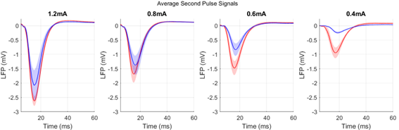
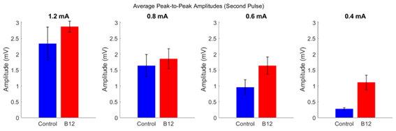

# Effects of Vitamin B12 Supplementation on Neural Activity in the Rat Barrel Cortex

**BEng Biomedical Engineering Research Project | University of Reading | 2024–2025**

An electrophysiological research project investigating the effects of vitamin B12 supplementation on sensory-evoked neural activity in the rat barrel cortex. The study involved local field potential (LFP) signal analysis, statistical testing and data visualisation using MATLAB and Microsoft Excel.

## Project Overview

Vitamin B12 plays an important role in maintaining neurological function, particularly through myelin synthesis and neurotransmitter regulation. Although vitamin B12 deficiency is associated with neurological impairments, the effects of supplementation on sensory cortical processing in healthy animals remain less understood.

This project investigated whether vitamin B12 supplementation influenced the amplitude and latency of sensory-evoked local field potentials recorded from the barrel cortex of rats during electrical whisker pad stimulation.

The research focused on identifying differences in neural responses between vitamin B12-supplemented and control groups across four stimulation intensities.

### Research Objectives

- Investigate the effects of vitamin B12 supplementation on sensory-evoked cortical responses.
- Analyse LFP signal characteristics, including peak amplitude, peak-to-peak amplitude and peak latency.
- Compare neural responses between experimental groups across different stimulation intensities.
- Evaluate statistical significance and effect sizes to identify treatment-related differences.

## Technologies and Methods

| Category | Tools and Techniques |
|---|---|
| Programming | MATLAB R2024b |
| Data Analysis | MATLAB, Microsoft Excel |
| Signal Processing | LFP signal averaging and parameter extraction |
| Statistical Analysis | ANOVA, two-sample t-tests, Jarque–Bera normality tests |
| Effect Size Analysis | Cohen's d |
| Data Visualisation | LFP waveforms, group comparisons and error-bar plots |
| Research Domain | Biomedical Engineering, Electrophysiology, Neuroscience |

## Experimental Design

The study involved electrophysiological recordings from adult female Lister Hooded rats assigned to two experimental groups.

| Experimental Group | Initial Sample | Final Sample |
|---|---|---|
| Control | 9 | 7 |
| Vitamin B12 | 10 | 7 |
| Total | 19 | 14 |

Five animals were excluded from the final analysis due to insufficient LFP responses at the lowest stimulation intensity.

### Stimulation Protocol

- **Stimulation intensities:** 0.4, 0.6, 0.8 and 1.2 mA
- **Stimulation frequency:** 5 Hz
- **Pulses per stimulus train:** 10
- **Trials per intensity:** 50
- **Sampling frequency:** 24,414 Hz
- **Analysed recording duration:** First 2 seconds

The experimental recordings were obtained by the supervising research group at the University of Reading.

### LFP Parameters

Three parameters were extracted from the neural responses:

1. **Peak amplitude:** Maximum voltage deflection used to quantify the strength of the neural response.
2. **Peak-to-peak (P2P) amplitude:** Difference between the maximum and minimum signal amplitudes.
3. **Peak latency:** Time between stimulus onset and the identified neural response peak.

Each parameter was examined across three response phases:

- **First pulse:** 0–0.2 seconds
- **Second pulse:** 0.2–0.4 seconds
- **Steady-state response:** Average responses to the eighth, ninth and tenth stimulus pulses

## Results and Visualisations

### 1. Group-Averaged Local Field Potential Responses

The figures below illustrate average LFP recordings for the control and vitamin B12 groups.

**Control Group**



**Vitamin B12 Group**



Both groups exhibited stimulus-evoked neural responses, with response amplitudes generally decreasing as stimulation intensity decreased.

### 2. First Pulse Responses



The vitamin B12 group generally exhibited larger negative LFP deflections at lower stimulation intensities, particularly at 0.4 mA.

The shaded regions represent the standard error of the mean (SEM), illustrating variability across animals.

### 3. Second Pulse Responses



Second pulse responses generally showed reduced amplitudes compared with the first pulse, consistent with sensory adaptation.

The vitamin B12 group maintained stronger responses at lower stimulation intensities.

### 4. Statistical Comparison of Peak-to-Peak Amplitude



The second pulse P2P amplitude comparison identified a statistically significant difference between experimental groups at 0.4 mA.

This result was associated with a large reported effect size.

Additional plots covering individual animal responses, average waveforms, peak amplitudes and response latencies are available in the `01_figures/` directory.

## Statistical Analysis

Statistical analyses were performed using Microsoft Excel and MATLAB.

The original dissertation reported two-factor ANOVA results examining the effects of experimental group and stimulation intensity, followed by two-sample t-tests and Cohen's d effect-size calculations.

The statistical results below reproduce the values reported in the original dissertation.

### Main Group Effects

| Response Phase | Parameter | Reported p-value |
|---|---|---|
| First pulse | Peak amplitude | 0.0569 |
| First pulse | P2P amplitude | **0.0479** |
| First pulse | Peak latency | 0.1268 |
| Second pulse | Peak amplitude | **0.0125** |
| Second pulse | P2P amplitude | **0.0096** |
| Second pulse | Peak latency | 0.1922 |
| Steady-state | Peak amplitude | 0.5552 |
| Steady-state | P2P amplitude | 0.6507 |
| Steady-state | Peak latency | **0.0322** |

**Bold values indicate statistical significance at p ≤ 0.05.**

### Significant Post-Hoc Comparisons

The following comparisons were statistically significant at the lowest stimulation intensity of 0.4 mA.

| Parameter | p-value | Cohen's d |
|---|---|---|
| First pulse P2P amplitude | 0.0281 | 1.33 |
| Second pulse peak amplitude | 0.0037 | 1.92 |
| Second pulse P2P amplitude | 0.0035 | 1.94 |

The reported effect sizes indicate substantial differences between experimental groups at low stimulation intensity.

Although steady-state latency showed a significant overall group effect, individual post-hoc comparisons did not reach the 0.05 significance threshold.

## Key Findings

- Vitamin B12 supplementation was associated with increased sensory-evoked LFP amplitudes, particularly at 0.4 mA stimulation.
- Statistically significant differences were identified in first pulse P2P amplitude and second pulse peak and P2P amplitudes.
- The largest reported effects occurred at the lowest stimulation intensity.
- Steady-state latency showed a significant overall group effect, although the individual post-hoc comparisons were not statistically significant.
- The findings suggest a possible relationship between vitamin B12 supplementation and enhanced cortical responsiveness to weak sensory stimulation.

These findings relate to an experimental rat model and do not establish equivalent effects in humans.

## Repository Structure

```text
vitamin-b12-neural-signal-analysis/
│
├── README.md
│
├── 01_figures/
│   ├── 01_group_responses/
│   │   ├── control_group_average_lfp.png
│   │   └── b12_group_average_lfp.png
│   │
│   ├── 02_individual_responses/
│   │   ├── first_pulse_control.png
│   │   ├── first_pulse_b12.png
│   │   ├── second_pulse_control.png
│   │   ├── second_pulse_b12.png
│   │   ├── steady_state_control.png
│   │   └── steady_state_b12.png
│   │
│   ├── 03_average_responses/
│   │   ├── first_pulse_average_lfp.png
│   │   ├── second_pulse_average_lfp.png
│   │   └── steady_state_average_lfp.png
│   │
│   └── 04_statistical_comparisons/
│       ├── peak_amplitude_first_pulse.png
│       ├── peak_amplitude_second_pulse.png
│       ├── peak_amplitude_steady_state.png
│       ├── p2p_amplitude_first_pulse.png
│       ├── p2p_amplitude_second_pulse.png
│       ├── p2p_amplitude_steady_state.png
│       ├── peak_latency_first_pulse.png
│       ├── peak_latency_second_pulse.png
│       └── peak_latency_steady_state.png
│
├── 02_reports/
│   ├── dissertation.pdf
│   └── research_poster.pdf
│
└── 03_data/
    └── lfp_parameters_and_statistical_analysis.xlsx
```

## Data and Documentation

The repository contains the following research outputs:

**Figures (`01_figures/`)**

Twenty visualisations generated during the original research project, including individual neural responses, group-averaged LFP recordings and statistical comparisons.

**Reports (`02_reports/`)**

- `dissertation.pdf`: Full undergraduate research dissertation, including background literature, experimental methods, results, discussion and conclusions.
- `research_poster.pdf`: Research poster summarising the experimental design, statistical findings and conclusions.

**Data (`03_data/`)**

- `lfp_parameters_and_statistical_analysis.xlsx`: Workbook containing LFP parameters extracted from waveform visualisations, alongside the original statistical testing results.

The parameter measurements in this workbook were extracted from LFP-versus-time visualisations. The workbook does not contain the original raw electrophysiological recordings.

## Code Availability and Reproducibility

The original signal processing and visualisation scripts were developed using MATLAB R2024b as part of the undergraduate research project.

These scripts are no longer available following the expiry of the university OneDrive account used during the project.

This repository therefore serves as an archive of the original research outputs rather than a fully executable or reproducible analysis pipeline.

The original waveform figures, extracted parameter data and statistical results have been retained for documentation and reference. The statistical calculations have not been independently reproduced as part of this repository.

## Limitations

The original research had several limitations:

- A relatively small final sample size of 14 animals.
- Exclusion of five animals due to weak responses at the lowest stimulation intensity.
- Some parameter distributions did not satisfy the normality assumption.
- The use of parametric statistical tests despite deviations from normality.
- Experimental findings limited to anaesthetised rats.
- The need for further research to establish the physiological mechanisms underlying the observed differences.

These factors should be considered when interpreting the reported findings.

## Project Documentation

The complete research reports are available below:

- [Undergraduate Dissertation](02_reports/dissertation.pdf)
- [Research Poster](02_reports/research_poster.pdf)
- [LFP Parameters and Statistical Analysis](03_data/lfp_parameters_and_statistical_analysis.xlsx)

## Acknowledgements

This project was completed as part of the BEng Biomedical Engineering programme at the University of Reading.

I would like to thank Professor Ying Zheng for her supervision and guidance, and Professor Zheng's research group for conducting the experimental procedures and providing the electrophysiological recordings used in this study.

## Author

**Uche Dumzo-Ajufo**

BEng Biomedical Engineering (First Class Honours)

University of Reading

*Undergraduate research project, 2025.*